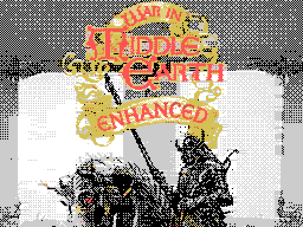
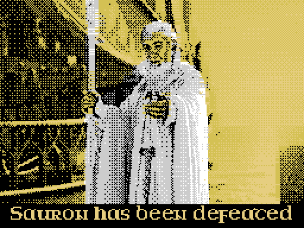
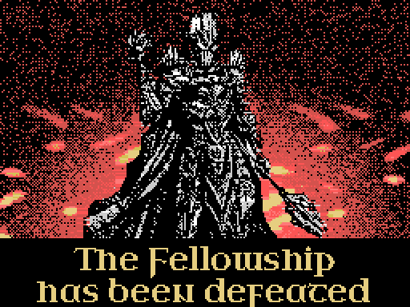

# The cartridge

The game shipped on cassette and takes **six and a half minutes** to load. This
turns it into a cartridge that boots in **nine seconds**, without changing a
single byte of the game.

There are two cartridges. The **plain** one is the game as it is, only without
waiting for the tape. The **enhanced** one also adds music, pictures and speed,
and is the one to play. This page covers the
enhanced one and how to build each of them.

## The enhanced cartridge

It starts from the patched tape and adds things that do not fit on tape. It is
the one to play and the one the testers get.

**Music.** *War in Middle Earth* for MSX has no music and no sound effects: it
is silent from start to finish. This cartridge carries three songs by
**Araubi**:

| when it plays | song |
|---|---|
| in the opening menu | *Niebla* |
| during the game, on the map | *Taberna* |
| from the moment a battle is announced until it ends | *Batalla* |

The **M key** turns the music off and, pressed again, back on.

**Three new pictures**, also by **Araubi**: the one shown while the game starts,
the one for winning and the one for losing. The original ones were those of the
ZX Spectrum version, which allows two colours per 8×8 pixel cell; the new ones
are made for the MSX, which allows two colours per 8-pixel line.

| on start-up | on winning | on losing |
|---|---|---|
|  |  |  |

**Six place names in full.** On the map, a sign pops up when you move over a
named place. Six did not fit and the game cut them short (the game is in
Spanish):

| on tape | on this cartridge |
|---|---|
| `Ptos Grises` | Puertos Grises |
| `Quebradas` | Quebradas Lejanas |
| `LosGamos` | Los Gamos |
| `Abism Helm` | Abismo de Helm |
| `Ga. Hierro` | Garganta de Hierro |
| `Puerta N` | Puerta Negra |

**And the rest**: the close-up view of the map runs thirteen times faster, the
cursor is a sprite, every army has a drawing on the map instead of just a
colour, the battle background follows the terrain, and there are two more
heroes, Tom Bombadil and Radagast. Each one is explained in the
[README](https://github.com/antxiko/WarinMiddleEarth-MSX-Patch/blob/main/README.md).

### Tested by playing

**Araubi tests every build by playing it**, and has played many whole battles
without trouble. That is how a bug turned up: on the overview map, the one
showing all of Middle Earth, the right-hand side came out as stripes instead of
the drawing.

The cause: that map was sent to the video chip at one byte every 22 clock
cycles, and the chip, with the picture on, needs about 29 between bytes. Those
that arrived too soon were lost: **4,094 of 6,144**. It is now sent at 39
cycles and arrives whole.

On top of that, an automatic check plays a game in the openMSX emulator and
checks that the three pictures reach the screen without a single byte changed,
that the right song plays at each moment, and that the M key turns it off and
back on.

What is left to do is in [open questions](OPEN-QUESTIONS.html).

## Building it

**There is no ROM here either.** You build it from your own tape:

    make rom          # war.rom, from the original tape
    make rom_parche   # war_parche.rom, from the patched one

Both come out at 64 KB, **ASCII16** type, and neither is distributed: they are
the whole game in a different case (see the [legal notice](https://github.com/antxiko/WarinMiddleEarth-MSX-Patch/blob/main/LEGAL-NOTICE.md)).

    openmsx -machine Philips_VG_8020 -carta war.rom -romtype ascii16

The enhanced cartridge is built with `make rom_unificada` and comes out as
`war_unificada.rom`. **It needs the songs and the pictures, which are not in this
repository yet**, so it does not work from a plain clone. The other two do.

How a tape game is made to start from a cartridge without changing anything in
it is told, in full technical detail, in
[Inside the cartridge](INSIDE-THE-CARTRIDGE.html).

## Who made what

The program that plays the songs is not ours. It is the **WYZ PSG proPLAYER**,
by **WYZ**, in the version that **theNestruo** (Néstor Sancho) publishes inside
the [msx-msxlib](https://github.com/theNestruo/msx-msxlib) library. That version keeps
the code apart from its variables, which is what lets it sit in a cartridge
ROM.

**The songs and the pictures belong to Araubi and are not in this repository
yet.** That is why `make rom_unificada` does not work from a plain clone: it
needs those files. `make rom` and `make rom_parche` do work.

## Thanks

- **Araubi** asked for this patch on the forum and is the one who tests it:
  played a whole game and sent the recording that exposed a bug hanging the
  game after eight minutes, and plays every build of the cartridge. The three
  songs and the three pictures are Araubi's too.
- **theNestruo** (Néstor Sancho) is the author of
  [msx-msxlib](https://github.com/theNestruo/msx-msxlib), where the music player comes
  from in the form used here.
- **WYZ** is the author of the player, the WYZ PSG proPLAYER.
- **Einar Saukas** is the author of [ZX0](https://github.com/einar-saukas/ZX0), the
  compressor used to store the pictures, the map and the songs in the ROM.
