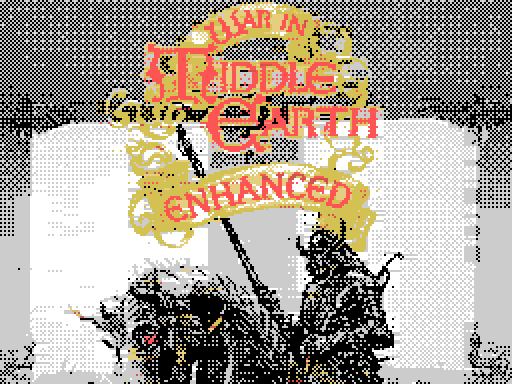
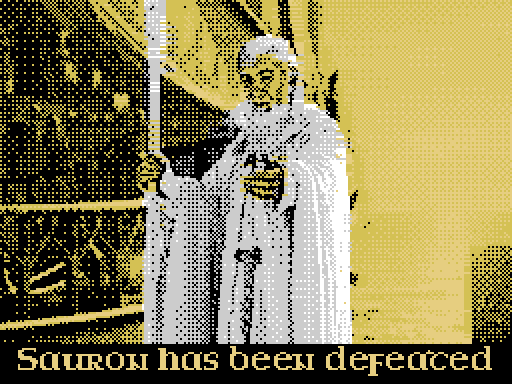
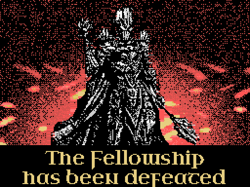

# El cartucho

El juego venía en cinta y tarda **seis minutos y medio** en cargar. Esto lo
convierte en un cartucho que arranca en **nueve segundos** sin cambiarle un
solo byte al juego.

Hay dos cartuchos. El **sencillo** es el juego tal cual, sólo que sin esperar a la
cinta. El **mejorado** además le añade música, ilustraciones y velocidad, y es el
que se juega. Esta página cuenta el mejorado y cómo se monta cada
uno.

## El cartucho mejorado

Parte de la cinta parcheada y le añade cosas que en cinta no caben. Es el que
se juega y el que reciben los testers.

**Música.** *War in Middle Earth* para MSX no tiene música ni efectos: es mudo
de principio a fin. Este cartucho lleva tres canciones de **Araubi**:

| cuándo suena | canción |
|---|---|
| en el menú inicial | *Niebla* |
| durante la partida, en el mapa | *Taberna* |
| desde que se anuncia una batalla hasta que termina | *Batalla* |

La **tecla M** quita la música y, pulsada otra vez, la vuelve a poner.

**Tres ilustraciones nuevas**, también de **Araubi**: la que se ve mientras el
juego arranca, la de ganar la partida y la de perderla. Las del juego original
eran las de la versión de ZX Spectrum, que sólo admite dos colores por cada
cuadro de 8×8 píxeles; las nuevas están hechas para el MSX, que admite dos
colores por cada línea de 8 píxeles.

| al arrancar | al ganar | al perder |
|---|---|---|
|  |  |  |

**Seis nombres de lugar completos.** En el mapa, al pasar por un lugar con
nombre sale un cartel. Seis no cabían y el juego los recortaba:

| en la cinta | en este cartucho |
|---|---|
| `Ptos Grises` | Puertos Grises |
| `Quebradas` | Quebradas Lejanas |
| `LosGamos` | Los Gamos |
| `Abism Helm` | Abismo de Helm |
| `Ga. Hierro` | Garganta de Hierro |
| `Puerta N` | Puerta Negra |

**Y lo demás**: la vista de cerca del mapa va trece veces más rápida, el cursor
es un sprite, cada ejército lleva un dibujo en el mapa en vez de sólo un color,
el fondo de la batalla cambia según el terreno y hay dos héroes más, Tom
Bombadil y Radagast. Cada cosa está explicada en el
[README](https://github.com/antxiko/WarinMiddleEarth-MSX-Patch/blob/main/README.es.md).

### Probado jugando

**Araubi prueba cada versión jugándola**, y ha jugado muchas batallas completas
sin problemas. Así apareció un fallo: en el mapa general, el que enseña la
Tierra Media entera, la parte derecha salía con rayas en lugar del dibujo.

La causa: ese mapa se mandaba al chip de vídeo a un byte cada 22 ciclos de
reloj, y el chip, con la imagen encendida, necesita unos 29 entre byte y byte.
Los que llegaban demasiado pronto se perdían: **4.094 de 6.144**. Ahora se
manda a 39 ciclos y llega entero.

Además, una comprobación automática juega una partida en el emulador openMSX y
comprueba que las tres ilustraciones llegan a la pantalla sin un byte cambiado,
que en cada momento suena la canción que toca y que la tecla M la quita y la
devuelve.

Lo que queda por hacer está en [preguntas abiertas](PREGUNTAS-ABIERTAS.html).

## Montarlo

**Aquí tampoco hay ninguna ROM.** Se monta de tu propia cinta:

    make rom          # war.rom, de la cinta original
    make rom_parche   # war_parche.rom, de la cinta ya parcheada

Las dos salen de 64 KB, del tipo **ASCII16**, y ninguna se reparte: son el
juego entero en otro envase (ver el [aviso legal](https://github.com/antxiko/WarinMiddleEarth-MSX-Patch/blob/main/AVISO-LEGAL.md)).

    openmsx -machine Philips_VG_8020 -carta war.rom -romtype ascii16

El cartucho mejorado se monta con `make rom_unificada` y sale en `war_unificada.rom`.
**Necesita las canciones y las ilustraciones, que todavía no están en este
repositorio**, así que con sólo clonarlo no funciona. Los otros dos sí.

Cómo consigue un juego de cinta arrancar desde un cartucho sin cambiarle nada
está contado, con todo el detalle técnico, en
[El cartucho por dentro](EL-CARTUCHO-POR-DENTRO.html).

## De quién es cada cosa

El programa que hace sonar las canciones no es nuestro. Es el **WYZ PSG
proPLAYER**, de **WYZ**, en la versión que **theNestruo** (Néstor Sancho)
publica dentro de la biblioteca [msx-msxlib](https://github.com/theNestruo/msx-msxlib).
Esa versión separa el código de sus variables, y eso es lo que permite tenerlo
en la ROM de un cartucho.

**Las canciones y las ilustraciones son de Araubi y todavía no están en este
repositorio.** Por eso `make rom_unificada` no funciona con sólo clonarlo:
necesita esos ficheros. `make rom` y `make rom_parche` sí funcionan.

## Gracias

- **Araubi** pidió este parche en el foro y es quien lo prueba: jugó una
  partida entera y mandó la grabación con la que se encontró un fallo que
  colgaba el juego a los ocho minutos, y juega cada versión del cartucho.
  Suyas son también las tres canciones y las tres ilustraciones.
- **theNestruo** (Néstor Sancho) es el autor de [msx-msxlib](https://github.com/theNestruo/msx-msxlib),
  de donde sale el reproductor de música tal como se usa aquí.
- **WYZ** es el autor del reproductor, el WYZ PSG proPLAYER.
- **Einar Saukas** es el autor de [ZX0](https://github.com/einar-saukas/ZX0), el
  compresor con el que van guardadas en la ROM las ilustraciones, el mapa y
  las canciones.
